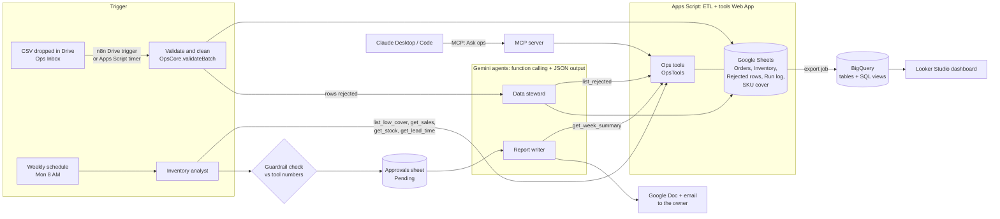

# Supplement ops agent

> **Demo data only.** "Kalye Nutrition" is a fictional supplement brand. Every order, SKU and number in this repo is synthetic and generated by `sample-data/generate.mjs`.

An internal-tools demo for a small supplement brand: weekly CSV uploads are validated and loaded into Google Sheets and BigQuery, SQL views and a dashboard show sales, margin and **days of cover**, and three AI agents explain bad data, suggest reorders and write the weekly report. Any MCP client (Claude Desktop, Claude Code) can ask the ops data questions directly.

## The problem

A small brand selling on its website, Shopee, Lazada and two physical stores ends up with:

- Sales exports in slightly different formats every week (dates, peso signs, duplicates, blank channels).
- No single view of stock across locations, so reorders are guessed or late.
- A weekly report someone builds by hand in a spreadsheet.

| | Before (manual) | After (this project) |
|---|---|---|
| Clean and merge weekly CSVs | about 45 min, errors found late | automatic on upload, bad rows land in "Rejected rows" with a reason and a suggested fix |
| Decide what to reorder | gut feel, about 30 min | ranked list with days of cover vs supplier lead time, suggestions wait in an Approvals sheet |
| Weekly report | about 45 min | written and emailed automatically, about 5 min to read and approve |

Time figures are estimates for a business of this size, not measured client results.

## Architecture: trigger to output



Step by step, with what each piece reads and writes: [docs/architecture.md](docs/architecture.md).

## What's in the repo

| Folder | What |
|---|---|
| `sample-data/` | Seeded generator (25 SKUs, 5 channels, 90 days, 3 locations) with patterns (paydays on the 15th/30th, a promo week, a trending SKU, dead stock, a supplier delay) and planted errors in every weekly batch. Output in `sample-data/out/`. |
| `apps-script/core/` | **Shared core**: validator/ETL (`OpsCore.js`), ops tools (`OpsTools.js`), agent loop and guardrails (`OpsAgents.js`). Plain JavaScript that runs unchanged in Apps Script and in Node. |
| `apps-script/` | Apps Script entry points: Sheets I/O, Drive inbox, Gemini call, Web App (`doPost`), report to Google Doc + email, fallback triggers. Pushed with `clasp`. |
| `sql/` | BigQuery: table schemas, reporting views (days of cover, weekly KPIs with week-over-week change, margin by category, data quality) and analysis queries (payday effect, SKU trend slopes, channel mix shift, reorder shortlist). |
| `tools/` | Tool schemas (`ops-tools.json`) and agent output schemas, the single source for Gemini, n8n and MCP. |
| `prompts/` | System prompts for the data steward, inventory analyst and report writer. |
| `n8n/` | Exported workflows: Drive trigger → ETL → steward, and weekly analyst → approvals → writer. No credentials inside. |
| `mcp-server/` | "Ask ops" MCP server (TypeScript, runs on Node 23.6+ with no build step). |
| `tests/` | `node:test` suites for everything that can run off Google. |
| `docs/` | Architecture walkthrough, setup steps, dashboard spec. |

## Data and SQL

Cleaned data lives in Google Sheets (easy for a non-technical team to read and edit) and is copied to **BigQuery** for SQL and the dashboard (`exportToBigQuery`: load jobs with explicit schemas, then the views in [sql/01_views.sql](sql/01_views.sql) are recreated).

What the analysis queries find in the demo data:

| Query | Result |
|---|---|
| [payday_effect.sql](sql/analysis/payday_effect.sql) | Paydays (15th, 30th) average 81.6% more revenue than other days. The day after is +39.3%. |
| [sku_trends.sql](sql/analysis/sku_trends.sql) | Least-squares slope of weekly units: Creatine Monohydrate 500g grows about 7.3% a week, the fastest in the catalog. |
| [channel_mix.sql](sql/analysis/channel_mix.sql) | Revenue share per channel, first 4 weeks vs last 4 weeks. |
| [reorder_shortlist.sql](sql/analysis/reorder_shortlist.sql) | The same 5 SKUs and order quantities as the analyst's `list_low_cover` tool. |

The SQL is checked locally by running it on DuckDB (through a small translator for the few date functions that differ) and comparing every SKU's days of cover, status and reorder quantity, and the weekly KPIs, with the JavaScript tools. Two independent implementations agree on the same data.

## Agents

All three agents run the same loop (`OpsAgents.runAgent`): Gemini gets the system prompt and **read-only** tool declarations, calls tools until it has what it needs, then returns a final answer as JSON that must match an output schema ([tools/output-schemas.json](tools/output-schemas.json)).

| Agent | Tools | Output |
|---|---|---|
| Data steward ([prompt](prompts/data_steward.md)) | `list_rejected` | Each rejected row explained in plain words, likely cause, exact fix, whether it is safe to auto-fix. Written next to the row in the sheet. |
| Inventory analyst ([prompt](prompts/inventory_analyst.md)) | `list_low_cover`, `get_sales`, `get_stock`, `get_lead_time`, `list_dead_stock` | Reorder suggestions `{sku, qty, reason, confidence}`. |
| Report writer ([prompt](prompts/report_writer.md)) | `get_week_summary` | One-page weekly report: sales, stock and reorders, data quality, watch list, actions. |

Design rules:

- **The model never does the math.** Days of cover, averages, margins and a baseline order quantity are computed in code the agents read, compare and explain.
- **Agents can't write.** The analyst only proposes. Code checks every suggestion against the tool numbers (unknown SKU, dead stock, not actually low, quantity outside 0.5x–2x of the baseline), saves it as `Pending` with any flags visible, and a person approves or rejects it in the sheet. Nothing is ever sent to a supplier.
- **Every run is logged**: tools called with their arguments, model calls, token use, validation problems and an output preview go to the Run log sheet.

## Run it locally (no Google account needed)

Needs Node 23.6 or newer (tested on Node 26).

```bash
npm run generate          # writes the demo CSVs to sample-data/out/
npm install               # dev only: DuckDB, to test the BigQuery SQL locally
npm test                  # 60 tests: generator, validator, tools, agent loop, SQL views vs tools, Web App gate, n8n JSON, secret scan
cd mcp-server && npm install && npm test   # starts the MCP server and calls every tool with the official client
```

**Ask ops from Claude Code:** open this folder in Claude Code `.mcp.json` registers the server (local backend, demo data). Approve it, then ask, for example, *"What will run out in the next 2 weeks?"*. It calls `list_low_cover`, `get_sales` and `get_stock` and shows the numbers it used.

**Claude Desktop:** add to `claude_desktop_config.json`:

```json
{ "mcpServers": { "supplement-ops": { "command": "node", "args": ["/absolute/path/to/supplement-ops-agent/mcp-server/server.ts"] } } }
```

To point the MCP server at the live Google Sheet instead of the local CSVs, copy `mcp-server/.env.example` to `mcp-server/.env` and fill in the Web App URL and token.

## Deploy on Google (free tier)

Sheets, Apps Script, Drive, BigQuery Sandbox, Looker Studio and the Gemini API free tier, plus n8n self-hosted. No billing. Full steps: [docs/setup.md](docs/setup.md). Dashboard spec: [docs/dashboard.md](docs/dashboard.md).

## Security and access

- **Secrets never in the repo.** The Gemini key and the Web App token live in Apps Script Script Properties, n8n holds the token in a Query Auth credential. The MCP server reads it from a gitignored `.env`. Exported n8n workflows contain placeholders and no credential IDs.
- **Pre-commit secret scan** (`npm run scan`, also a test) blocks API keys, OAuth tokens, private keys, real deployment URLs, n8n credential references, and a local list of words that must never be published.
- **Web App** requires a token of 24+ characters (compared in constant time) and fails closed if none is set. It only accepts files that are inside the Ops Inbox folder.
- **Least privilege:** OAuth scopes are limited to Sheets, BigQuery, Drive read-only, Docs, sending mail as the owner, external requests (Gemini) and triggers. Reports are emailed only to the script owner.
- **Human in the loop** for anything that would cost money (reorders).
- **What a real company would add:** a service account instead of a personal account, a Web App behind Google sign-in or Cloud Run with IAM instead of a shared token, BigQuery dataset permissions per role, audit logging to Cloud Logging, and data retention rules.

## What is tested, and what is not yet

Tested locally (`npm test`, `mcp-server npm test`): data generator, validator with every planted error, all tools against hand counts, every SQL view and analysis query on DuckDB cross-checked against the tools, the BigQuery loader's schema against the SQL tables, the agent loop with a scripted fake model (tool routing, read-only enforcement, step limit, schema checks, guardrail flags), Web App token gate and routing with faked Google services, n8n JSON structure, secret scan, and the MCP server end to end over stdio.

Not run yet: anything that needs Google or n8n: Sheets and Drive I/O, BigQuery load jobs and the views on BigQuery itself, real Gemini calls, Doc and email output, Looker Studio, and importing/running the n8n workflows. Those are checked by hand during setup, this section will be updated when they are.

## How I worked with AI

I decided the workflow, the business rules (what counts as low stock, what an agent may and may not do, what needs human approval) and how it should fail, tested it, and shipped it. AI coding tools (Claude Code) wrote much of the code under that direction. The agents inside the product use Google's Gemini API.

## Roadmap (v2)

Cloud Run for the tools API and MCP server so it runs without a laptop, BigQuery as the main store instead of a copy, a Shopee/Lazada export mapper, and a CrewAI or LangChain version for comparison.

## License

MIT
